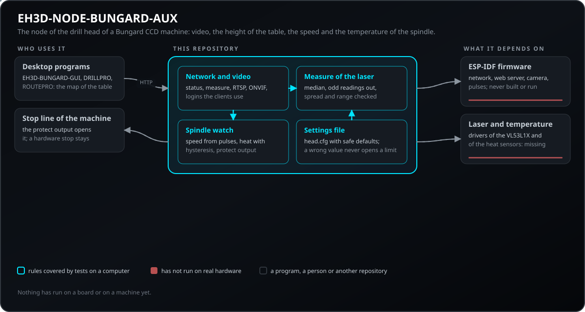
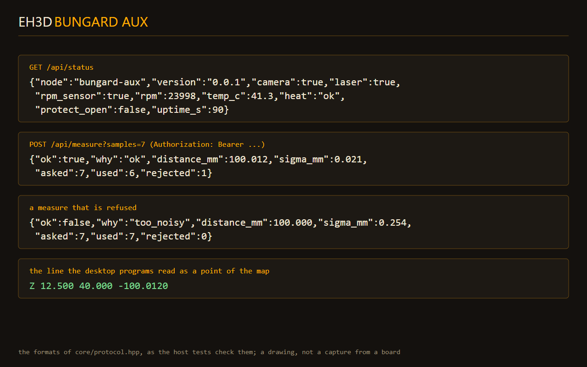
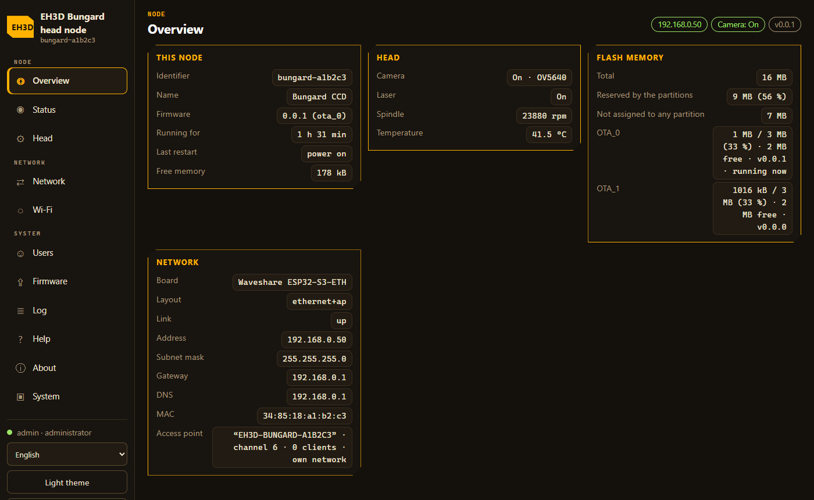
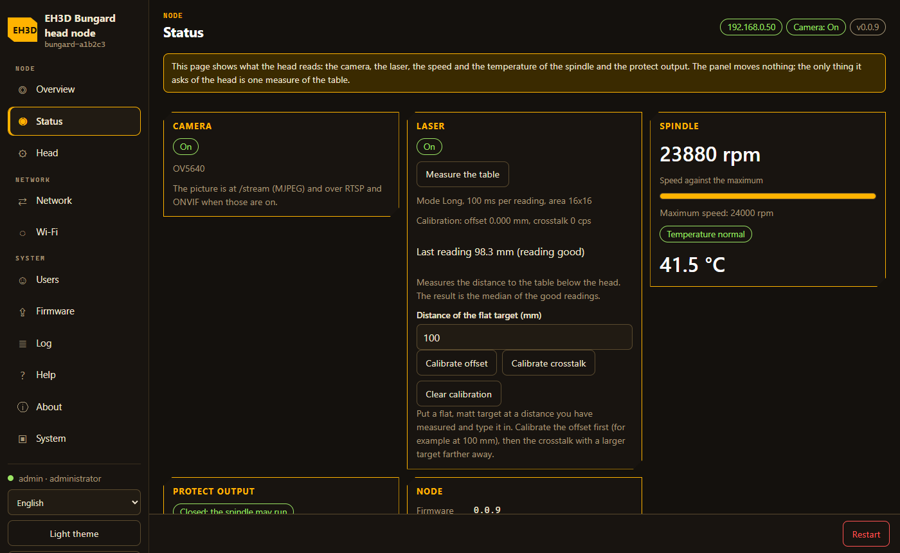
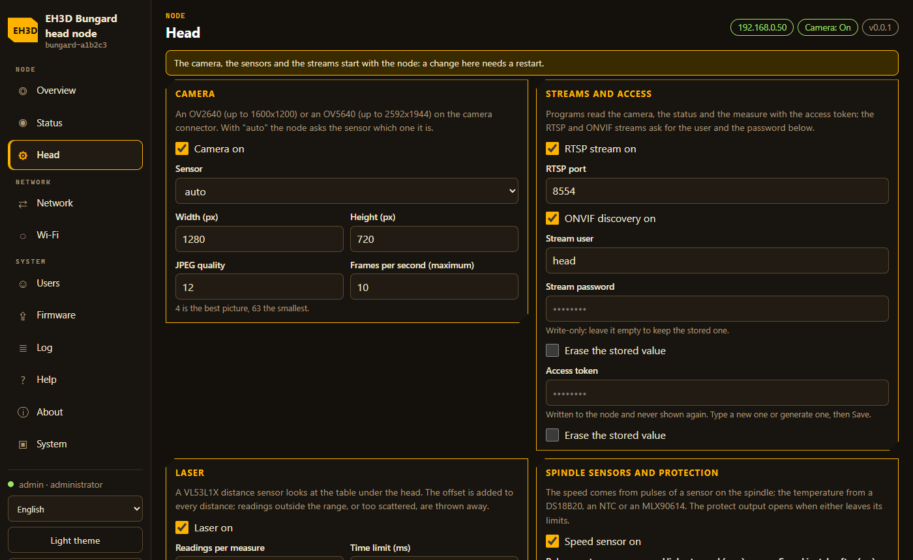
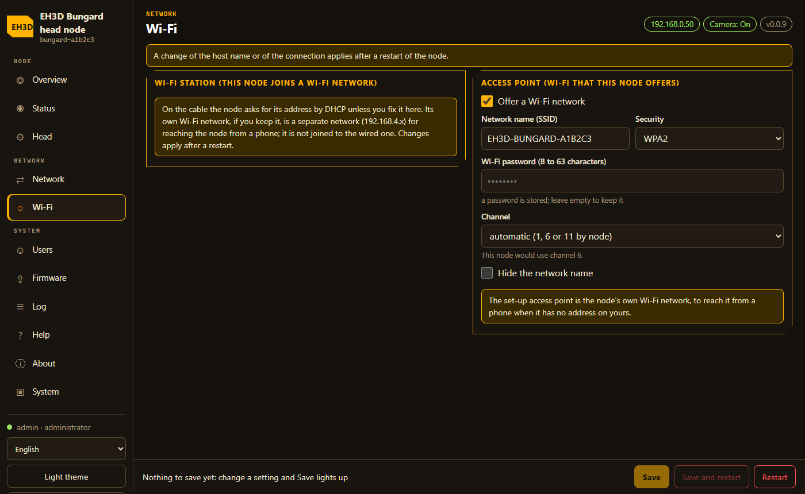
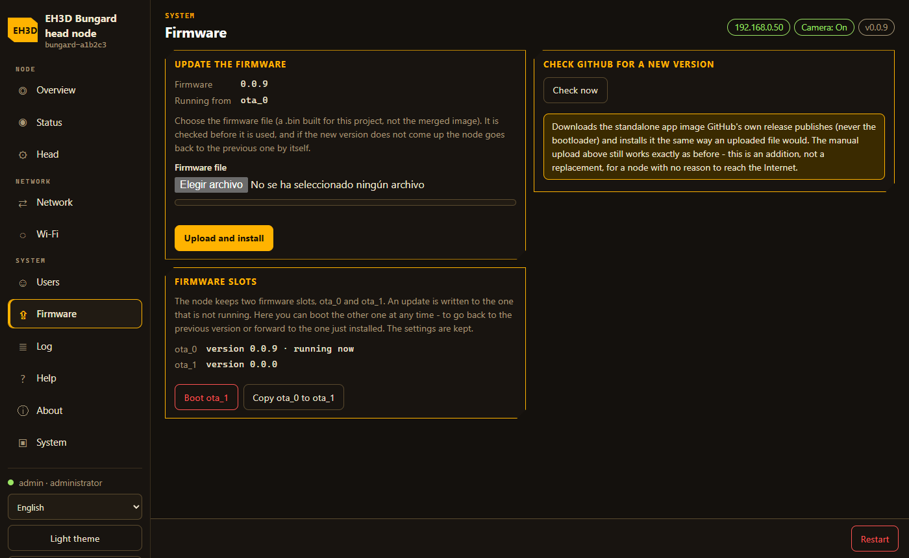
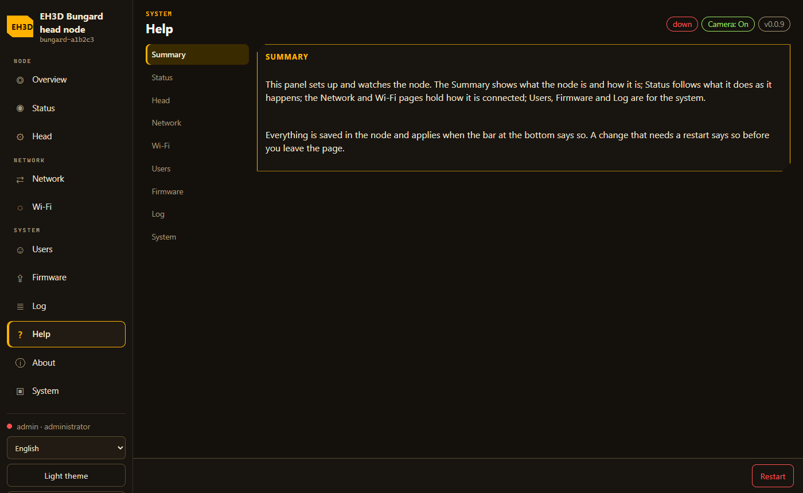
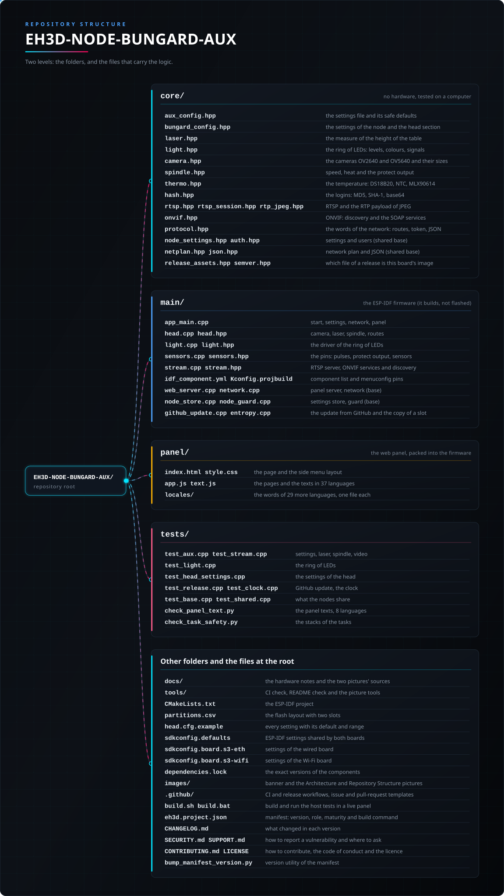

<p align="center">
  
</p>

# 🎛️ EH3D-NODE-BUNGARD-AUX

<p align="center"><a href="README.md">🇺🇸 English</a> | <a href="README_spa.md">🇪🇸 Español</a> | <a href="README_fra.md">🇫🇷 Français</a> | 🇮🇹 <b>Italiano</b> | <a href="README_deu.md">🇩🇪 Deutsch</a> | <a href="README_zho.md">🇨🇳 中文</a> | <a href="README_jpn.md">🇯🇵 日本語</a> | <a href="README_por.md">🇵🇹 Português</a></p>

### Un piccolo nodo sulla testa di foratura di una macchina Bungard CCD (ESP32-S3 con porta di rete cablata): invia il video della telecamera, misura l'altezza del tavolo con un laser, legge la velocità e la temperatura del mandrino e apre un'uscita di protezione quando il mandrino è troppo veloce o troppo caldo.

<p align="center">
  
  
  
  
  
</p>

---

**Verifica di onestà - cosa funziona oggi:** le regole del nodo sono scritte in C++17 e provate su un computer: il file delle impostazioni con i suoi valori sicuri, la misura dell'altezza del tavolo da più letture del laser (quelle anomale vengono scartate e una misura troppo dispersa è rifiutata), la velocità del mandrino dagli impulsi di un sensore, la temperatura con avviso, livello critico e isteresi, l'uscita di protezione e le parole che il nodo dice in rete (lo stato, la misura, il token). Il firmware ESP-IDF (rete cablata, server web, telecamera, impulsi del mandrino, uscita di protezione) è scritto e si compila con ESP-IDF 5.5.5, ma non è mai stato caricato né eseguito su una scheda; **i driver del laser (VL53L1X), dei sensori di temperatura (DS18B20, NTC, MLX90614) e della telecamera (OV2640 o OV5640) sono scritti ma non sono mai stati eseguiti su una scheda**, quindi non è mai stata fatta una misura, e nulla è stato collegato a una macchina.

---

> **Stato di sicurezza (safety) e di sicurezza informatica:** questo non è un sistema di sicurezza (safety). L'uscita di protezione è un segnale per la linea di arresto dell'unità di controllo, non un suo sostituto: l'arresto che protegge le persone e la macchina è un pulsante hardware che taglia l'azionamento da solo. L'uscita si apre quando il mandrino è troppo veloce o troppo caldo, quando un sensore di temperatura attivo non risponde e quando questo nodo non è in funzione; un nodo senza token rifiuta ogni richiesta che misura o mostra la telecamera. Non farci affidamento finché l'intera catena non è stata provata su una macchina reale. Il progetto è indipendente: non è realizzato, approvato né sostenuto da Bungard Elektronik, e i nomi di prodotto compaiono solo per dire con quali macchine è pensato per funzionare.

## 📋 In breve

| | |
|---|---|
| Versione | `0.0.8` |
| Maturità | Impalcatura |
| Test | 14 programmi di test sul computer |
| Stack tecnologico | C++17, ESP-IDF 5.5, ESP32-S3, rete W5500 |
| Su hardware reale | No: il firmware si compila ma non è stato caricato, e nulla è stato collegato a una macchina |

**Vai a:** [Panoramica](#-panoramica) · [Architettura](#-architettura) · [Avvio rapido](#-avvio-rapido) · [Test](#-test) · [Struttura](#-struttura-del-repository) · [Correlati](#-progetti-correlati)

## 🚦 Stato del progetto
Ogni riga è una parte di questo repository e il semaforo dice a che punto è oggi. È scritta in base a ciò che il repository può mostrare (test, compilazioni, esecuzioni), non a ciò che è previsto.

🟢 Fatto e verificato · 🟡 Funziona, con limiti noti · 🟠 Fatto a metà o non ancora verificato · 🔴 Non fatto o non funzionante

| Area | Stato | Cosa significa qui |
|---|---|---|
| Software | 🟠 | Il progetto ESP-IDF (rete cablata con un W5500, server web, telecamera, impulsi del mandrino, uscita di protezione, il file delle impostazioni nella sua partizione) è scritto e si compila; non è stato caricato. |
| Test | 🟡 | 14 programmi di test passano (`ctest`): le impostazioni, la misura del laser, la velocità e la temperatura del mandrino, l'uscita di protezione, le parole della rete, il video (RTSP, ONVIF), il documento delle impostazioni della testa, l'aggiornamento da GitHub, l'orologio, ciò che condividono tutti i nodi, i testi del pannello in 37 lingue e gli stack dei task. |
| Laser (altezza del tavolo) | 🟡 | La misura da più letture (mediana, letture anomale scartate, dispersione verificata, intervallo e offset) è provata; il driver del VL53L1X è scritto ma non è mai stato eseguito, quindi non è ancora stata fatta alcuna misura. |
| Mandrino | 🟡 | La velocità dagli impulsi di un sensore (qualsiasi numero per giro, fermo quando gli impulsi cessano), la temperatura con avviso, livello critico e isteresi e l'uscita di protezione sono provate; i driver del DS18B20, dell'NTC e dell'MLX90614 sono scritti ma non sono mai stati eseguiti. |
| Telecamera | 🟠 | Il flusso MJPEG è scritto per il connettore della telecamera della scheda e richiede i pin della scheda in menuconfig; non è stato eseguito. |
| Video (RTSP, ONVIF) | 🟡 | La sessione RTSP (OPTIONS, DESCRIBE, SETUP, PLAY, PAUSE, TEARDOWN, su UDP o dentro la connessione TCP, accesso Digest e Basic), il payload RTP di JPEG, la discovery e i servizi SOAP di ONVIF (profili, encoder con le loro dimensioni, indirizzi del flusso e dello snapshot, il token utente) sono provati su un computer; nessun player o registratore ha preso il video da una scheda reale. |
| Hardware reale | 🔴 | Nessuna scheda ha eseguito questo firmware e nulla è stato collegato a una macchina. |
| Documentazione | 🟡 | README in otto lingue, il riferimento delle impostazioni e le note sull'hardware. |

## 🎯 Panoramica

* La **misura del laser**: il nodo chiede al sensore più letture, scarta quelle anomale (mediana e deviazione assoluta mediana), rifiuta una misura che si disperde più di `laser_sigma_max_mm` o che cade fuori dall'intervallo, e risponde con la distanza dal tavolo e la dispersione; i programmi desktop la trasformano in un punto della mappa del tavolo (`Z x y altezza`, letto da `eh3d-levelling`).
* Il **mandrino**: la velocità deriva dagli impulsi di un sensore (un sensore hall o un disco con fessure, qualsiasi numero di impulsi per giro) ed è zero quando gli impulsi cessano; la temperatura ha un avviso, un livello critico e un'isteresi perché lo stato non sfarfalli; un sensore attivo che non risponde conta come caldo.
* L'**uscita di protezione**: un GPIO basso ogni volta che il mandrino deve fermarsi (troppo veloce, troppo caldo, un sensore muto) e anche mentre il nodo non è in funzione, da collegare alla linea di arresto dell'unità di controllo tramite un relè o un optoaccoppiatore; si può disattivare nelle impostazioni.
* L'**uscita protect è sorvegliata**: il task che la scrive è iscritto al watchdog dei task e figura tra i task che il guardiano del nodo si aspetta, quindi un blocco riavvia il chip, il pin torna ingresso e la linea di arresto si apre, invece di lasciare l'uscita aperta per sempre. Nulla di questo è stato eseguito su una scheda.
* La **telecamera e la rete**: il video della telecamera come MJPEG su `/stream` e le letture su `/api/status`, tramite una porta di rete cablata (W5500 su SPI); il token protegge la misura e la telecamera.
* Le **impostazioni**: ogni valore regolato (la rete, la telecamera, il laser, il mandrino, la temperatura, l'uscita di protezione) è un'impostazione del nodo, conservata nella flash e modificata nel pannello web, mai un numero nel codice; un valore fuori intervallo viene rifiutato con il motivo.
* Il **video come lo invia una telecamera IP**: RTSP (`rtsp://INDIRIZZO/stream1`, JPEG su RTP, su UDP o dentro la connessione TCP, con accesso Digest o Basic) e ONVIF (WS-Discovery, perché registratori e gestori trovino il nodo, e i servizi del profilo S: profili, encoder con le dimensioni che la telecamera può fare, l'indirizzo del flusso e dello snapshot, il token utente); entrambi usano utente e password delle impostazioni, e senza password non si serve nulla.
* **Il pannello e l'aggiornamento, come gli altri nodi:** il nodo ha il pannello web dei nodi di A.R.M.O.R. e di EH3D-NODE-BUNGARD (il menu a gruppi con la lingua e la chiusura della sessione in fondo; un Riepilogo; una pagina Wi-Fi con fino a tre reti di riserva per quando cade la principale; una pagina Testa che modifica le impostazioni di telecamera, flussi, laser e mandrino; Aiuto; Informazioni; utenti; il registro), la copia di uno slot del firmware sull'altro in entrambe le direzioni e l'aggiornamento dall'ultima release di GitHub di questo progetto (si verifica lo SHA-256 pubblicato dalla release, l'indirizzo deve essere quello del progetto e lo richiede solo un amministratore; le release non sono firmate). Condivide la base del firmware con EH3D-NODE-BUNGARD.

## 🧩 Ruolo in EH3D

EH3D-NODE-BUNGARD-AUX è il nodo della testa di foratura di una macchina Bungard CCD, accanto a EH3D-NODE-BUNGARD (il nodo che comanda la macchina) e EH3D-NODE-BUNGARD-HMI (lo schermo). Sta sulla testa, vede la scheda con la sua telecamera, misura il tavolo sotto la testa e sorveglia il mandrino. I programmi desktop (EH3D-BUNGARD-GUI, DRILLPRO, ROUTEPRO) usano le sue misure per costruire la mappa del tavolo (`eh3d-levelling` in EH3D-COMMON) e correggere la Z dei lavori; EH3D-BUNGARD-GUI interroga il nodo direttamente o tramite EH3D-SERVER (la finestra del nodo della testa).

## 🏛️ Architettura

<p align="center">
  
</p>

Come si incastrano le parti di questo repository: chi parla con esso, cosa contiene e da cosa dipende. Il disegno nasce da `docs/architecture.json` ed è verificato sul codice.

## 🖼️ Schermate

<p align="center">
  
</p>

<p align="center"><em>Ciò che il nodo risponde in rete: lo stato (`GET /api/status`), una misura del tavolo (`POST /api/measure`) e la riga che i programmi desktop leggono come un punto della mappa. Un disegno dei formati che le prove verificano, non una cattura da una scheda.</em></p>

<p align="center">
  
</p>

<p align="center"><em>La pagina Riepilogo: il nodo, il suo hardware, il suo orologio, la sua flash con i due slot di firmware e la sua rete.</em></p>

<p align="center">
  
</p>

<p align="center"><em>La pagina Stato, nel tema Forge degli altri programmi EH3D.</em></p>

<p align="center">
  
</p>

<p align="center"><em>La pagina Testa: telecamera, flussi, laser, sensori del mandrino e uscita di protezione (password e token di sola scrittura).</em></p>

<p align="center">
  
</p>

<p align="center"><em>La pagina Wi-Fi: la rete a cui si unisce il nodo e fino a tre reti di riserva in caso di perdita.</em></p>

<p align="center">
  
</p>

<p align="center"><em>La pagina Firmware: l'aggiornamento da GitHub, il caricamento di un file e i due slot, con la copia dell'uno sull'altro.</em></p>

<p align="center">
  
</p>

<p align="center"><em>La pagina Aiuto: un argomento per ogni pagina del pannello.</em></p>

## ✨ Funzionalità

* **Una misura affidabile, o nessuna:** più letture, quelle anomale scartate, e un rifiuto (con il motivo) quando le letture si disperdono troppo, sono fuori intervallo o sono troppo poche.
* **Un mandrino sorvegliato sempre:** velocità dagli impulsi, temperatura con un avviso, un livello critico e un'isteresi, e un'uscita di protezione che si apre da sola quando qualcosa non va o il nodo non è in funzione.
* **Video come una telecamera IP:** RTSP e ONVIF con accesso, perché lo prenda qualsiasi player, registratore o gestore ONVIF; e la telecamera come MJPEG su `/stream` dietro il token.
* **Sicuro per impostazione predefinita:** senza token niente misura né telecamera; ogni limite ha un interruttore nelle impostazioni e parte dalla posizione conservativa.
* **Due telecamere, la OV2640 e la OV5640:** il sensore dice quale è e il nodo dà la dimensione più grande che le impostazioni permettono e che quel sensore può dare (la OV2640 fino a 1600x1200, la OV5640 fino a 2592x1944), la riporta su `/api/status` (`camera_model`) e nelle opzioni dell'encoder di ONVIF; `camera_model = auto | ov2640 | ov5640` in la pagina Testa. I pin del connettore telecamera della Waveshare ESP32-S3-ETH sono i valori predefiniti di `menuconfig`.
* **Tre sensori di temperatura:** un DS18B20 su un filo, un termistore NTC su un ingresso analogico (`ntc_series_ohm`, `ntc_r25_ohm`, `ntc_beta` in la pagina Testa) o un termometro a infrarossi MLX90614 che guarda il mandrino senza toccarlo (sul bus I2C del laser); i checksum e le conversioni sono testati su un computer.
* **Un anello di LED attorno alla telecamera:** otto LED RGB di tipo WS2812 su un solo filo illuminano la zona sotto la testa perché la telecamera veda bene. Il bianco è la luce per la telecamera; i livelli seguono l'occhio e non superano mai un limite; un solo lato dà una luce radente; si può chiedere qualsiasi colore, e l'anello dice com'è andato un controllo (verde, rosso lampeggiante, un punto blu che gira, ambra, rosso veloce). Si spegne da solo dopo un po'. `GET` e `POST /api/light` e `GET /api/snapshot` servono i programmi; le impostazioni sono nel pannello e in `head.cfg` (`light_*`), il pin nel menu del firmware (`AUX_LIGHT_GPIO`).
* **Un nodo che si giudica da solo, e una testa che non c'è:** lo stato porta un verdetto (`selfcheck`: ok, warn, fail) e i codici che lo spiegano (`selfcheck_codes`: una telecamera che non è partita, un guasto del laser o una lettura vecchia, impulsi di velocità rumorosi, un mandrino tiepido o caldo, un sensore di temperatura muto, nessun token ...); i limiti sono le impostazioni `selfcheck_*` di `head.cfg`. `core/head_sim.hpp` è una testa di foratura simulata (un tavolo non piano, un mandrino che accelera e si scalda, guasti che si possono attivare) che risponde come il firmware; le chiavi e i codici sono in [docs/CONTRACT.md](docs/CONTRACT.md) e un test tiene uguali la pagina e le risposte. Provato su un computer; non eseguito su una scheda.
* **37 lingue:** il pannello web del nodo parla inglese, spagnolo, italiano, tedesco, francese, portoghese, cinese, giapponese, bulgaro, croato, ceco, danese, olandese, estone, finlandese, greco, ungherese, irlandese, lettone, lituano, maltese, polacco, rumeno, slovacco, sloveno, svedese, norvegese, islandese, ucraino, russo, serbo, albanese, catalano, galiziano, basco, portoghese del Brasile e francese del Canada. Le parole dei 29 lingue oltre le prime otto sono tradotte dal modello e attendono la revisione di madrelingua; un testo che manca a una lingua appare in inglese.
* **Una barra di salvataggio sempre presente e una copia di sicurezza delle impostazioni:** Salva e Salva e riavvia sono sempre nelle pagine con impostazioni (spenti, con una nota, finché non cambia qualcosa), Riavvia è sempre a portata di mano per un amministratore, e la pagina Sistema esporta tutte le impostazioni in un file (con le password Wi-Fi e il token: tienilo privato) e le reimporta nei moduli senza inviare nulla, così ogni pagina si salva con il proprio Salva; l'id, il nome e il nome host del nodo non vengono mai cambiati da un'importazione. La pagina Rete modifica anche il nome, il server orario, il fuso orario e il riavvio periodico, e le reti Wi-Fi di riserva ora contano come modifica e vengono inviate al salvataggio. Scritto per il browser; non provato su una scheda.
* **Il laser, adattato al lavoro:** il VL53L1X ha una modalità di distanza (corta o lunga) e un budget di tempo, un'area di ricezione che si può restringere per guardare un punto piccolo, un filtro che scarta le letture lontane dalla mediana, uno stato per ogni lettura (valida, segnale debole, dispersione alta, fuori portata) e una calibrazione a distanza nota (offset e crosstalk) che un amministratore deve prima attivare. Non ancora provato su un sensore.
* **Più DS18B20 sullo stesso filo:** il nodo cerca sul filo tutti i sensori (con il CRC di ogni indirizzo), prende quello del mandrino dal suo indirizzo (`temp_rom`, o l'unico, o il primo trovato con un avviso nella pagina di stato), imposta la risoluzione da 9 a 12 bit (`temp_resolution`) e aspetta solo quanto serve a quella risoluzione. Provato su un computer con un bus simulato; non ancora provato su un filo reale.
* **Un sensore di velocità che distingue il rumore dai giri:** il TCRT5000 (riflettente, con il suo segno sul mandrino) funziona con l'uscita digitale su interrupt, o con l'uscita analogica letta da un ADC veloce e un trigger di Schmitt le cui soglie seguono il segnale; si filtrano gli impulsi più veloci di quanto il mandrino possa girare, i picchi a metà giro e gli impulsi persi, e lo stato dice se gli impulsi sono puliti o rumorosi. Provato con treni di impulsi simulati a 400 Hz e 1 kHz; non ancora provato su un mandrino.
* **L'immagine della telecamera, regolata dal pannello:** specchio, capovolgimento, luminosità, contrasto, saturazione, esposizione automatica o manuale e bilanciamento del bianco automatico, applicati a OV2640 e OV5640 all'avvio della telecamera (un'impostazione che un sensore non ha viene lasciata com'è). Non ancora provato su una telecamera.

## 🔒 Sicurezza e protezione

| Minaccia | Difesa |
|---|---|
| Un mandrino troppo veloce o troppo caldo | l'uscita di protezione si apre sopra `rpm_max` e alla temperatura critica, con un'isteresi perché non sfarfalli; un sensore di temperatura attivo e muto conta come caldo |
| Il nodo perde l'alimentazione o si blocca | l'uscita è bassa finché il nodo non ha controllato il mandrino e resta bassa mentre non è in funzione, quindi va cablata come un arresto che si apre da solo |
| Qualcuno in rete misura o guarda l'officina | senza token il nodo rifiuta la misura e la telecamera; il token è confrontato in tempo costante e non viene mai mostrato né registrato |
| Una misura sbagliata presa per buona | le letture anomale sono scartate, una dispersione oltre `laser_sigma_max_mm`, un intervallo o poche letture rifiutano la misura con il motivo |
| Un errore di battitura nelle impostazioni | un valore fuori intervallo o una chiave sconosciuta viene segnalato e resta il valore sicuro; una temperatura critica sotto l'avviso, o un intervallo capovolto, torna ai valori predefiniti |
| Un segreto nel firmware o nel repository | nulla di segreto è compilato; il token è un'impostazione nella sua partizione |

**Ciò che non è difeso:** il nodo non è un dispositivo di sicurezza. L'uscita di protezione vale quanto il cablaggio che la porta alla linea di arresto, e nulla di questo è stato provato su una macchina. La porta di rete non è cifrata (una semplice porta HTTP nella rete dell'officina): tienila su una rete a parte.

## 🔌 Interfacce

| Interfaccia | Che cos'è | Dove |
|---|---|---|
| Impostazioni | un documento nella flash, modificato nella pagina Testa del pannello web; le chiavi sono quelle di `head.cfg.example` | `core/bungard_config.hpp`, `core/aux_config.hpp` |
| Stato | `GET /api/status`: il nodo, la telecamera, il laser, la velocità, la temperatura, l'uscita di protezione e il tempo di accensione in una riga di JSON | `core/protocol.hpp` |
| Misura | `POST /api/measure[?samples=N]` con il token: la distanza dal tavolo, la dispersione e perché una misura è stata rifiutata | `core/laser.hpp`, `main/app_main.cpp` |
| Telecamera | `GET /stream` con il token: MJPEG | `main/app_main.cpp` |
| Impulsi del mandrino | un GPIO (`AUX_RPM_GPIO` in menuconfig), fronti di salita | `main/sensors.cpp` |
| Uscita di protezione | un GPIO (`AUX_PROTECT_GPIO`), basso quando il mandrino deve fermarsi | `main/sensors.cpp` |
| Laser e temperatura | I2C per il laser e un filo per il sensore di temperatura; i driver sono scritti e non sono mai stati eseguiti (il termometro MLX90614 condivide il bus I2C, il DS18B20 usa un pin, l'NTC un ingresso analogico) | `main/sensors.cpp` |
| RTSP | `rtsp://INDIRIZZO:PORTA/stream1`: OPTIONS, DESCRIBE, SETUP, PLAY, PAUSE, GET_PARAMETER, TEARDOWN; JPEG su RTP su UDP o interleaved in TCP; accesso Digest o Basic | `core/rtsp.hpp`, `core/rtsp_session.hpp`, `core/rtp_jpeg.hpp`, `main/stream.cpp` |
| ONVIF | WS-Discovery all'indirizzo multicast `239.255.255.250:3702`; SOAP su `/onvif/device_service` e `/onvif/media_service` (profilo S: capacità, servizi, profili, encoder, indirizzi del flusso e dello snapshot); lo snapshot su `/snapshot.jpg` | `core/onvif.hpp`, `main/stream.cpp` |

## ⚙️ Configurazione

Le impostazioni sono conservate nella flash come un unico documento e si modificano nella pagina Testa del pannello web (le password e il token sono di sola scrittura: il pannello non li mostra mai). Le chiavi e i loro intervalli sono quelli elencati in `head.cfg.example`; il file la pagina Testa delle versioni precedenti non viene più letto.

| Impostazione | Predefinito | Intervallo | Cosa fa |
|---|---|---|---|
| `token` | none | 8 - 64 | il token di accesso; senza di esso il nodo rifiuta la misura e la telecamera |
| `laser_samples` | `7` | 1 - 31 | letture di una misura (la mediana di quelle buone) |
| `laser_offset_mm` | `0` | -50 - 50 | si somma a ogni distanza: dove sta il sensore sopra la punta dell'utensile |
| `laser_sigma_max_mm` | `0.15` | 0.01 - 5 | una misura le cui letture si disperdono più di questo è rifiutata |
| `rpm_pulses_per_rev` | `1` | 1 - 64 | impulsi del sensore per ogni giro del mandrino |
| `rpm_max` | `65000` | 1000 - 200000 | sopra questa velocità si apre l'uscita di protezione |
| `temp_sensor` | none | none ds18b20 ntc mlx90614 | il sensore della temperatura del mandrino |
| `temp_warn_c / temp_critical_c` | `55 / 70` | 20 - 200 | l'avviso e il livello a cui si apre l'uscita di protezione |
| `protect_output` | `on` | on / off | l'uscita di protezione funziona; disattivala solo sul banco |
| `stream_user / stream_password` | `viewer / none` | 8 - 64 | l'accesso di RTSP e ONVIF; senza password non servono nessuno |
| `rtsp_port` | `554` | 1 - 65535 | la porta del server RTSP (quella del server web è `port`) |

## 🚀 Avvio rapido

Servono un compilatore C++17 e CMake per le prove sul computer, ed ESP-IDF 5.5.5 per il firmware (il target ESP32-S3).

```bash
build.bat            # le prove sul computer (Windows)  -  ./build.sh su Linux
python -I tools/ci_validate.py
```

Il firmware si compila con ESP-IDF 5.5.5: `idf.py set-target esp32s3 && idf.py menuconfig && idf.py build` produce l'immagine (imposta i pin della tua scheda in `EH3D Bungard AUX`), e le impostazioni si fanno nel pannello web quando il nodo è in funzione.

## 🧪 Test

Le prove sul computer (`build.bat` o `./build.sh`, poi `ctest`) sono due programmi e tutto passa: `test_aux` (103 verifiche) sul file delle impostazioni (valori predefiniti, valori, valori errati, limiti che non hanno senso insieme), la misura del laser (la mediana, la lettura anomala scartata, l'offset, letture segnate come cattive, l'intervallo, nessuna lettura, una dispersione troppo grande), la velocità del mandrino (impulsi per giro, un mandrino che rallenta, fermo quando gli impulsi cessano), la temperatura (l'isteresi, un sensore che si guasta), l'uscita di protezione e le parole della rete (la riga di richiesta, i percorsi, il token nell'intestazione o nella query, il numero di letture, il JSON dello stato e della misura, la riga di un punto della mappa). Il firmware non è coperto: si compila, ma le prove sono sul computer. Il secondo programma, `test_stream` (100 verifiche), copre il video: gli hash degli accessi contro i loro vettori pubblicati (MD5, SHA-1, base64 e l'esempio Digest dell'RFC 2617), le richieste RTSP e tutta la sessione (accesso, SDP, trasporto UDP e interleaved, play, pause, teardown, una sessione errata, multicast rifiutato), il payload RTP di JPEG (le tabelle nel primo pacchetto, l'ordine, il marcatore, il ritorno a zero della sequenza) e ONVIF (discovery, il token utente con l'esempio dello standard, le chiamate aperte e quelle protette, i servizi e una chiamata non eseguita). Oltre a quei due programmi, `test_head_settings` legge, controlla e scrive la sezione della testa del documento delle impostazioni come fa il pannello (le password e il token restano di sola scrittura), e i test condivisi della base del firmware coprono l'aggiornamento da GitHub, l'orologio e gli utenti.

Autotest per il giorno in cui la testa incontra l'hardware: `python tools/selftest.py --host NODO --token TOKEN` legge il nodo (versione, stato, esportazione delle impostazioni, reti di riserva, temperatura, giri, luce, immagine della camera, flusso, RTSP, una lettura del laser) e scrive un rapporto con una riga per passo; con `--active` e una conferma digitata accende anche l'anello di luce per due secondi e lo rimette com'era. Non esegue mai la calibrazione del laser. I suoi test girano nella CI contro un nodo finto (`python -I -m unittest discover -s tools -p "test_*.py"`). I passi manuali sono in [docs/HARDWARE_CHECKLIST.md](docs/HARDWARE_CHECKLIST.md).

## 🏗️ Compilazione e rilascio

La versione è in `eh3d.project.json`, e ogni versione ha la sua voce in [CHANGELOG.md](CHANGELOG.md). `build.sh` / `build.bat` compilano ed eseguono le prove sul computer e `test.sh` / `test.bat` eseguono i controlli del repository. Il firmware si compila con ESP-IDF 5.5.5 (`idf.py build`), cosa che non è ancora stata fatta; nessuna release è stata pubblicata.

## 🩺 Risoluzione dei problemi

| Sintomo | Cosa fare |
|---|---|
| Una misura viene rifiutata con `no_readings` | Nessun VL53L1X risponde sul bus I2C: controlla i pin SDA e SCL in `menuconfig` (la telecamera usa i GPIO 41 e 42 sulla Waveshare ESP32-S3-ETH) e il cablaggio; il resto della risposta è testato. |
| Una misura viene rifiutata con `too_noisy` | Le letture si disperdono più di `laser_sigma_max_mm`: lascia assestare testa e tavolo, o alza un poco il limite; controlla che nulla vibri. |
| Il nodo risponde 401 a una misura o alla telecamera | Imposta `token` in la pagina Testa (da 8 a 64 caratteri) e invialo nell'intestazione `Authorization: Bearer ...` o in `?token=`. |
| L'uscita di protezione è sempre aperta | Un sensore di temperatura attivo che non risponde conta come caldo: controlla il suo filo e il suo pin in `menuconfig` e `temp_sensor` in la pagina Testa, oppure imposta `temp_sensor = none` sul banco. |

## 📂 Struttura del repository

<p align="center">
  
</p>

<details>
<summary>Versione testuale dell'albero</summary>

```text
EH3D-NODE-BUNGARD-AUX/
├── core/
│   ├── aux_config.hpp                           il file delle impostazioni e i suoi valori sicuri
│   ├── self_check.hpp                           il giudizio del nodo su sé stesso, con codici
│   ├── head_sim.hpp                             una testa che non c'è, per prove e programmi
│   ├── bungard_config.hpp                       le impostazioni del nodo e la sezione della testa
│   ├── laser.hpp                                la misura dell'altezza del tavolo
│   ├── laser_hw.hpp                             i registri del laser
│   ├── light.hpp                                l'anello di LED: livelli, colori, segnali
│   ├── camera.hpp                               le telecamere OV2640 e OV5640 e le loro dimensioni
│   ├── spindle.hpp                              il sensore di velocità: impulsi, rumore, Schmitt
│   ├── thermo.hpp                               la temperatura: DS18B20, NTC, MLX90614
│   ├── onewire.hpp                              il bus 1-Wire: ricerca, indirizzo, risoluzione
│   ├── hash.hpp                                 gli accessi: MD5, SHA-1, base64
│   ├── rtsp.hpp rtsp_session.hpp rtp_jpeg.hpp   RTSP e il payload RTP di JPEG
│   ├── onvif.hpp                                ONVIF: discovery e servizi SOAP
│   ├── protocol.hpp                             le parole della rete: percorsi, token, JSON
│   ├── node_settings.hpp auth.hpp               impostazioni, utenti (base)
│   ├── netplan.hpp json.hpp                     piano di rete e JSON (base)
│   └── release_assets.hpp semver.hpp            quale file di una versione è l'immagine di questa scheda
├── main/
│   ├── app_main.cpp                             avvio, impostazioni, rete, pannello
│   ├── head.cpp head.hpp                        telecamera, laser, mandrino, rotte
│   ├── light.cpp light.hpp                      il driver dell'anello di LED
│   ├── sensors.cpp sensors.hpp                  i pin: impulsi, uscita di protezione, sensori
│   ├── stream.cpp stream.hpp                    server RTSP, servizi ONVIF e discovery
│   ├── idf_component.yml Kconfig.projbuild      elenco dei componenti e pin di menuconfig
│   ├── web_server.cpp network.cpp               server pannello, rete (base)
│   ├── node_store.cpp node_guard.cpp            archivio, guardiano (base)
│   └── github_update.cpp entropy.cpp            l'aggiornamento da GitHub e la copia di uno slot
├── panel/
│   ├── index.html style.css                     la pagina e la disposizione del menu laterale
│   ├── app.js text.js                           le pagine e i testi in 37 lingue
│   └── locales/                                 le parole di altre 29 lingue, un file ciascuna
├── tests/                                       test su computer di impostazioni, varco, voce e testi delle schermate
├── docs/                                        le note hardware, il contratto con i programmi e le fonti dei disegni
├── tools/                                       controllo CI, README e strumenti dei disegni
├── CMakeLists.txt                               il progetto ESP-IDF
├── partitions.csv                               la mappa della flash con due slot
├── head.cfg.example                             ogni impostazione con il suo default e intervallo
├── sdkconfig.defaults                           impostazioni ESP-IDF comuni alle due schede
├── sdkconfig.board.s3-eth                       impostazioni della scheda cablata
├── sdkconfig.board.s3-wifi                      impostazioni della scheda Wi-Fi
├── dependencies.lock                            le versioni esatte dei componenti
├── images/                                      banner e le immagini di Architettura e Struttura del repository
├── .github/                                     workflow di CI e di rilascio, modelli di issue e pull request
├── build.sh build.bat                           compila ed esegue i test su computer in un pannello dal vivo
├── eh3d.project.json                            manifesto: versione, ruolo, maturità e comando di compilazione
├── CHANGELOG.md                                 cosa è cambiato in ogni versione
├── SECURITY.md SUPPORT.md                       come segnalare una vulnerabilità e dove chiedere
├── CONTRIBUTING.md CODE_OF_CONDUCT.md LICENSE   come contribuire, codice di condotta e licenza
└── bump_manifest_version.py                     utilità di versione del manifesto
```

</details>

## 🗺️ Roadmap e limiti noti

**Limiti noti oggi**

* Nulla è stato eseguito su una scheda: il firmware si compila ma non è stato caricato né provato, e i pin della telecamera e del chip di rete vanno controllati con lo schema della scheda.
* I driver del laser (VL53L1X via I2C, con il componente `grrtzm/vl53l1x_library`, poco usato), dei sensori di temperatura e della telecamera sono scritti e non sono mai stati eseguiti: il primo sensore che risponde su una scheda può mostrare un errore.
* EH3D-BUNGARD-GUI (la finestra del nodo della testa) e EH3D-SERVER interrogano il nodo, direttamente o tramite il server; nessuno dei due è stato provato con un nodo reale.
* La porta di rete è HTTP semplice: tienila su una rete a parte.
* RTSP e ONVIF non sono stati provati con un player, un registratore o un gestore ONVIF reali; il modello della telecamera sulla scheda deciderà dimensioni e pin.

**Prossimi passi**

* Compilare il firmware e provare i driver su una scheda.
* Aggiungere il collegamento con EH3D-BUNGARD-GUI, con EH3D-SERVER e con lo schermo, e la vista della telecamera.
* Provare l'uscita di protezione cablata a una linea di arresto su una macchina.

## 🌍 Lingue

Il README e i testi esistono in inglese, spagnolo, francese, italiano, tedesco, cinese, giapponese e portoghese europeo.

## 🔗 Progetti correlati

* [EH3D-BUNGARD-GUI](https://github.com/JuanenRac/EH3D-BUNGARD-GUI): l'interfaccia moderna che usa le misure per costruire la mappa del tavolo
* [EH3D-NODE-BUNGARD](https://github.com/JuanenRac/EH3D-NODE-BUNGARD): il nodo sulla porta seriale dell'unità di controllo che comanda la macchina
* [EH3D-NODE-BUNGARD-HMI](https://github.com/JuanenRac/EH3D-NODE-BUNGARD-HMI): lo schermo touch dell'operatore
* [EH3D-SERVER](https://github.com/JuanenRac/EH3D-SERVER): il centro della famiglia: porterà le risposte del nodo a ogni client
* [EH3D-COMMON](https://github.com/JuanenRac/EH3D-COMMON): le parti comuni della famiglia, tra cui `eh3d-levelling` (la mappa delle altezze del tavolo)

## 📚 Documentazione

* Le impostazioni: `head.cfg.example` elenca ogni chiave con il suo valore predefinito e il suo intervallo.
* L'hardware: i pin, il cablaggio dell'uscita di protezione e i componenti, in `docs/HARDWARE.md`.
* [Registro delle modifiche](CHANGELOG.md)

## 🤝 Contribuire e comunità

* Prima di una pull request esegui i test sul computer (`./build.sh` o `build.bat`) e `python -I tools/ci_validate.py`: tutto deve passare. Vedi [CONTRIBUTING.md](CONTRIBUTING.md) e il [codice di condotta](CODE_OF_CONDUCT.md).
* Il README esiste in otto lingue: una modifica del testo si fa in tutti e otto i file, e i due disegni nascono da `docs/architecture.json` e `docs/structure.json` con `tools/make_architecture.py` e `tools/make_structure.py`.
* Nulla che cambi il modo in cui il nodo dà una misura o apre l'uscita di protezione cambia senza una prova che lo copra e una nota di quanto osservato sull'hardware.
* Segnala una vulnerabilità in privato: [SECURITY.md](SECURITY.md). Domande, idee e segnalazioni: electrohobby3d@gmail.com ([SUPPORT.md](SUPPORT.md)).

## 👤 AUTORE

**JuanenRac (Electro Hobby 3D)** · electrohobby3d@gmail.com

## 📜 LICENZA

Software: GPL-3.0-or-later. Vedi [LICENSE](LICENSE). I progetti hardware della suite usano la CERN OHL-S.
